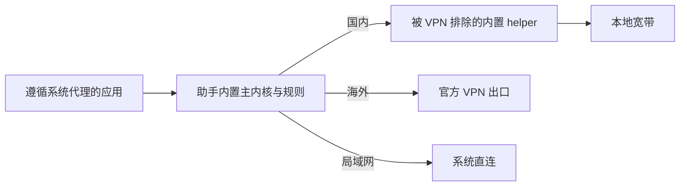

# 分流助手

Windows 桌面分流工具：国内流量经本地宽带，海外流量经官方 VPN。支持 **Windscribe** 和 **Mullvad**，由一个界面完成配置准备、组件启停、链路检测、系统代理管理和登录启动。

**当前版本为 0.2.4（桌面预览版）**。修复启用分流后后台维护导致的周期性界面闪动。内置主内核、规则库和直连 helper，**无需 Clash Verge，无需另行下载 helper，Windscribe 无需代理网关或网关密码**。Windows 10/11 x64 自包含程序，无需另装 .NET。

- [下载安装包、便携包及 SHA-256](https://github.com/CainDez/splithelper/releases/tag/v0.2.4)
- [安装、升级与日常使用](desktop/README.md)
- [0.2.4 更新说明](desktop/releases/v0.2.4.md) · [验证记录与边界](desktop/verification/QA-v0.2.4.md)

网站访问异常时，可在“设置 → [自定义规则](desktop/README.md#自定义规则)”输入域名或网址，选择国内直连、VPN 或拦截。支持子域名、启停和优先级排序。点击“保存并应用”即提交规则。

## 开始使用

1. 安装分流助手，在官方 VPN 客户端完成登录并选择节点。
2. 打开助手的“设置 → 连接向导”，将**随包 helper** 加入 VPN 的应用排除列表。Windscribe 使用 Exclusive / 排除模式；主内核和助手保留在 VPN 内。
3. Windscribe 选择 **IKEv2 或 WireGuard**，关闭不再需要的 **Proxy Gateway / 代理网关**。如果其他设备仍通过该网关共享 VPN，可为它们保留；分流助手不会使用它。
4. 点击“一键启用”，确认“分流已启用”和各项检查通过。需要自动运行时，在“自动启动”勾选登录启动、自动启用，保存偏好。

**Windows 系统代理由分流助手管理。** Clash Verge 的系统代理、PAC、代理守卫保持关闭，Clash Verge 可以退出。关闭 Windscribe 的“代理网关”不等于关闭 VPN 连接，也不等于关闭助手正在使用的 Windows 系统代理。

从 0.2.x 更新时，先停止分流并从托盘退出，再覆盖安装，保留原有本机数据和 helper 排除项，详见[0.2.x 更新步骤](desktop/README.md#从-02x-更新)。从 0.1.x 升级首次启用会迁移已确认属于助手的活动规则，迁移前请保留旧 Clash 配置，详见[旧版升级指南](desktop/README.md#从-01x-升级)。

## 连接方式

| VPN | 海外路径 | 本机需要配置 |
|---|---|---|
| Windscribe | 主内核绑定 IKEv2 / WireGuard VPN 接口 | 官方客户端登录、helper 排除；不需要代理网关 |
| Mullvad | 隧道内 `10.64.0.1:1080` SOCKS5 | 官方客户端登录、helper 排除 |

只有 helper 被 VPN 排除，负责国内公网流量。普通 `DIRECT` 跟随系统路由，不能替代 `ChinaDirect`。主内核和 helper 均只监听回环地址；启用期间助手负责恢复 Windscribe 连接与自己的主内核，停止或退出时还原代理。

## 使用与测试

- 在助手里检查国内、海外链路；再用浏览器打开国内视频和海外页面。
- 停止分流时应还原原代理；启用“启动助手后自动检测并启用分流”后，重新打开应自动恢复。
- 勾选“关闭窗口时保留在系统托盘”后，点窗口关闭只隐藏窗口；完全退出请使用托盘菜单。
- 遇到冲突，先按“代理管理归属”检查的提示处理，避免多个程序同时管理系统代理。

0.2.3 通过 127 项自动化测试。Windows 候选构建验证了 GeoSite 和 GeoIP 的后台下载、重启后保留数据，以及自定义规则的列表和编辑界面。详见 [0.2.3 QA](desktop/verification/QA-v0.2.3.md)。Windscribe IKEv2 断线恢复和视频分流的既有验收见 [0.2.2 QA](desktop/verification/QA-v0.2.2.md) 和 [0.2.0 QA](desktop/verification/QA-v0.2.0.md)。

适用范围是**遵循 Windows 系统代理的 HTTP/HTTPS/TCP 应用**，TUN 和 IPv6 关闭。没有覆盖绕过系统代理的应用、UDP、其他 Windscribe 协议或整机防泄漏；本轮未做 Mullvad 动态复测和 Windows 重启后登录验收。安装包未签名，本版保持预览版发布状态。

## 项目内容

| 目录 | 用途 |
|---|---|
| `desktop/` | WPF 桌面端、测试、固定组件清单、打包脚本和验证记录 |
| `providers/` | 共用规则模板及旧 Clash 方案的订阅级 DNS 脚本 |
| `docs/legacy-script-setup.md` | 保留的旧脚本版操作说明，不适用于 0.2.x 桌面设置 |
| `ui-prototype/` | 设计原型，启停与链路状态为演示数据 |
| `tests/` | 旧脚本与 DNS 转换回归检查 |

[桌面构建与验证](desktop/README.md#构建和验证) · [旧脚本版与 Clash 配置](docs/legacy-script-setup.md) · [隐私和迁移边界](PRIVACY.md)

源码仓库不提交第三方二进制和本机运行数据。安装包携带经过 SHA-256 校验的固定版本组件、规则数据、许可证及对应源码归档。账号、旧网关凭据、私人规则和运行记录留在本机。
