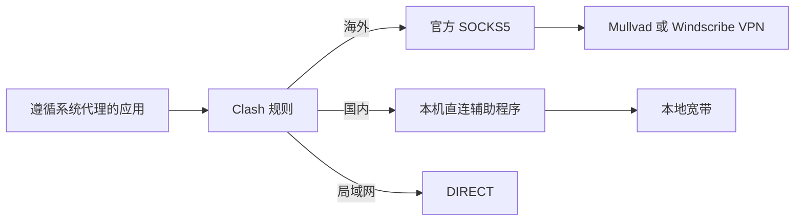

# 旧脚本版与 Clash Verge 配置

本文仅适用于保留的脚本版及旧桌面网关方案。桌面端 0.2.0 请使用[新版安装与升级指南](../desktop/README.md)，无需 Clash Verge 或 Windscribe Proxy Gateway。以下命令均从仓库根目录执行。

## 选择方案

| VPN | 海外出口 | 配置与步骤 |
|---|---|---|
| Mullvad | 隧道内 `10.64.0.1:1080` SOCKS5 | [Mullvad 配置说明](../providers/mullvad/README.md) |
| Windscribe | 官方客户端的本地认证 SOCKS 网关 | [Windscribe 配置说明](../providers/windscribe/README.md) |



主 Clash 内核留在 VPN 内，只有直连辅助程序被排除。普通 `DIRECT` 按系统路由出站，通常仍进入 VPN；国内公网规则因此使用 `ChinaDirect`。

Windscribe 另有一条防回环规则：网关交回 Clash 的 Windscribe 进程请求使用 `DIRECT`，由主 Clash 按系统 VPN 路由发出。原因和验收方法见 [Windscribe 说明](../providers/windscribe/README.md#系统代理回环与修复)。

## 文件布局

```text
providers/
  mullvad/       主配置、订阅级 DNS 脚本、Mullvad 步骤
  windscribe/    配置示例、订阅级 DNS 脚本、Windscribe 步骤
direct.yaml      共用的国内直连辅助配置
Initialize-Helper.ps1
Start-Helper.cmd / Start-Helper.ps1
Stop-Helper.cmd / Stop-Helper.ps1
Enable-Autostart.ps1
tests/
```

Mullvad 模板保留 524 条通用规则；Windscribe 在对应规则前增加一条防回环规则，共 525 条。模板已去除个人域名规则，数量可能与原机器的私人配置不同。

Git 源码仓库不提交第三方二进制。桌面安装包包含经 SHA256 校验的官方 Mihomo 直连组件，以及许可证和对应版本源码归档。网关密码、账号、订阅链接、私人规则和运行记录保存在本机，详见 [PRIVACY.md](../PRIVACY.md)。

## 共用准备步骤

### 1. 准备辅助程序

在新机器安装 Clash Verge Rev 和所选 VPN 官方客户端，把本仓库放在固定目录。在仓库根目录打开 Windows PowerShell：

```powershell
.\Initialize-Helper.ps1
```

非默认安装路径可以明确指定：

```powershell
.\Initialize-Helper.ps1 -CorePath 'C:\Path\To\Clash Verge\verge-mihomo.exe'
```

脚本从已安装的 Clash Verge 复制内核并校验 SHA256，仅生成本目录的 `mullvad-direct-helper.exe`。它不启动进程，也不配置 VPN、系统代理或自启动。

**辅助程序和启动快捷方式保留历史文件名，供两套方案共用。** 文件名包含 Mullvad 不影响 Windscribe 使用，也避免已有应用排除项和自启动路径因改名失效。已有运行实例时，以它的实际运行目录为准，继续复用该实例。

脚本遵循本机现有 PowerShell 执行策略。浏览器下载的文件若被 Windows 标记阻止，应先审阅并确认来源，再在文件属性中解除阻止；也可以通过 Git 克隆取得文件。

### 2. 在所选 VPN 中排除辅助程序

按照对应方案说明，只将本机辅助程序的实际路径加入 VPN 应用排除列表。主 `verge-mihomo.exe` 继续留在 VPN 内。Windscribe 方案还要求主 `Windscribe.exe` 保持原 VPN 路由。

### 3. 启动辅助程序

双击仓库根目录的 `Start-Helper.cmd`。辅助程序仅监听 `127.0.0.1:18997`，看到 `Started` 或 `Already running` 后可以关闭提示窗口。

启动脚本复用本目录的现有实例；端口被其他进程占用时会报错。停止脚本仅停止本目录的辅助程序。

### 4. 完成所选方案

- [Mullvad：配置应用分流、导入配置和 DNS 脚本](../providers/mullvad/README.md)
- [Windscribe：开启网关、填写本机认证、配置防回环](../providers/windscribe/README.md)

先准备并验证配置，最后手动切换订阅和系统代理。更新本仓库不会自动部署到其他运行目录。

## 自启动：以实际运行目录为准

辅助程序运行正常后，在仓库根目录运行：

```powershell
.\Enable-Autostart.ps1 -WhatIf
.\Enable-Autostart.ps1
```

- 已有唯一运行实例时，使用该实例的实际目录。
- 指定目录与运行实例不同，或发现多个运行目录时，脚本拒绝修改。
- 没有运行实例时，使用明确指定的目录或脚本所在目录。
- 只维护当前用户 Startup 中的 `Mullvad Domestic Direct Helper.lnk`，后台启动对应目录的 `Start-Helper.ps1`。
- 保留 Windows 已有的启动项禁用状态，复用运行中的辅助进程。

新机器应重新生成启动快捷方式，并在 VPN 中重新添加本机辅助程序的排除项。

## 本机配置与隐私

把包含网关密码或个人规则的配置保存在根目录 `local/` 下，并使用 `*.local.yaml` 文件名。这两层均已被 Git 忽略。Windscribe 示例必须先复制到该目录，再填写实际信息。

只共享脱敏模板、脚本和说明；保留私人规则时使用本地副本。发布包从已审查的 Git 提交生成。

## 验证范围

已在 Windows、Clash Verge Rev 2.4.7、Mihomo 1.19.21 下验证：

- Mullvad 2026.5：官方 SOCKS5、国内辅助路径、DNS 分流和拦截规则。
- Windscribe 2.24.13：认证 SOCKS 网关、国内辅助路径、系统代理开启后的防回环、进程规则命中、国内外 DNS 和网站访问。

Windscribe 必须在 **系统代理开启** 时验收；只在关闭时测试成功不足以证明组合可用。两套方案均未主动断开真实 VPN 做断线验收，也未宣称支持全系统 TUN、所有软件协议或长期重连。

## 开发检查

部署无需 Python 或 Node。修改后可在仓库根目录运行以下开发检查，JavaScript 检查需要 Node：

```powershell
powershell.exe -NoProfile -File .\tests\Test-Portable.ps1
node .\tests\profile-dns.test.cjs
```

PowerShell 检查使用临时目录、端口冲突检查和自启动 dry run，不改实际启动项或连接。DNS 检查覆盖两套订阅脚本，并确认规则、节点和 TUN 状态被保留。

旧脚本版从本机 Clash Verge 复制内核，源码仓库不提交其二进制。桌面发布包另外携带固定版本组件及对应许可证和源码归档。
